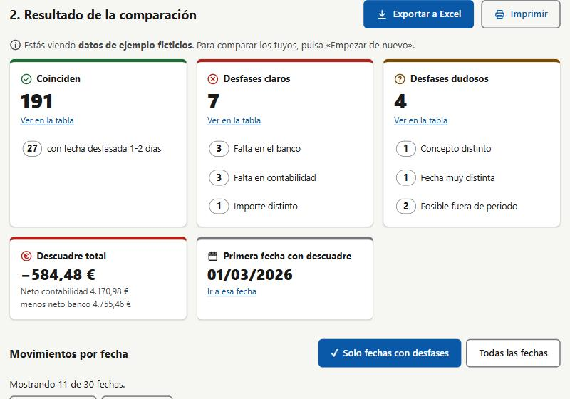

# Comparador contable

**Comprueba en un minuto si tu contabilidad cuadra con el banco.**

Eliges el Excel que exporta tu programa de contabilidad y el extracto que descargas del banco, y la web te
dice qué movimientos coinciden, cuáles faltan en un lado o en otro y cuáles conviene revisar. Sin instalar
nada, sin crear cuentas y sin que tus datos salgan de tu ordenador.

<!-- Cuando la web esté publicada, añade aquí el enlace: **[Pruébala aquí](https://…)** -->



## El problema

Quien lleva sus propias cuentas suele apuntar los cobros y pagos en un programa de contabilidad y, cada
mes, comprobar que coinciden con lo que dice el banco. Hecho a mano consiste en poner los dos listados uno
junto a otro e ir tachando, día por día, cientos de movimientos. Es lento, aburrido y fácil equivocarse:

- el banco carga un recibo un par de días después de cuando se apuntó,
- el concepto no se parece («Iberdrola luz» frente a «RECIBO IBERDROLA CLIENTES SAU»),
- un importe se tecleó mal, o un movimiento se quedó sin apuntar,
- y al final del mes algunos movimientos caen en el extracto del mes siguiente.

Comparador contable hace ese cruce automáticamente y deja a la vista solo lo que hay que revisar.

## ¿Para quién es?

- **Autónomos y pequeños negocios** que llevan su propia contabilidad o la preparan para la gestoría.
- **Asociaciones, comunidades de vecinos y clubes** que tienen que cuadrar la caja con la cuenta del banco.
- **Particulares** que llevan un control de gastos en una hoja de cálculo o en una aplicación.

No hace falta saber nada de informática: si sabes exportar un Excel de tu programa y descargar el extracto
de tu banco, sabes usarla. Está pensada también para personas mayores o con baja visión (ver
[Accesibilidad](#accesibilidad)).

## Qué hace

- **Lee los dos archivos** tal como salen de cada programa: `.xlsx`, `.xls` o `.csv`, con títulos, filas
  vacías, totales o saldos alrededor de la tabla.
- **Empareja los movimientos uno a uno**, tolerando pequeñas diferencias de fecha y conceptos escritos de
  otra forma (ver [Cómo decide si dos movimientos coinciden](#cómo-decide-si-dos-movimientos-coinciden)).
- **Resume el resultado**: cuántos movimientos coinciden, qué falta en el banco o en la contabilidad, qué
  importes no cuadran, el descuadre total en euros y la primera fecha en la que algo no encaja.
- **Muestra una tabla por días** con el descuadre acumulado; cada día se despliega para ver los movimientos
  de los dos lados emparejados.
- **Exporta un informe en Excel** con el resumen, los desfases, la tabla por fecha y las coincidencias.
- **Imprime** solo los desfases o el informe completo.
- **Se puede instalar como aplicación** y funciona sin conexión a Internet.

## Privacidad

Los extractos bancarios son datos delicados, así que la web está hecha para no necesitar a nadie más:

- **Todo ocurre en tu navegador.** Los archivos se leen en tu ordenador y nunca se envían a ningún servidor.
  De hecho, no hay servidor: es una página estática.
- **No guarda nada.** Al cerrar la pestaña, los datos desaparecen. Solo recuerda el tamaño de letra y los
  colores que elijas.
- **Sin cuentas, sin cookies, sin analíticas.**
- **Bloqueo técnico de conexiones**: la página tiene una política de seguridad (Content-Security-Policy) que
  impide que su código haga cualquier petición a Internet, incluso aunque alguien intentara colar código.

## Cómo se usa

1. Exporta los movimientos del mes desde tu programa de contabilidad y descarga el extracto del mismo
   periodo desde tu banco. Cada archivo debe tener cuatro columnas en este orden:

   | Fecha | Concepto | Entradas | Salidas |
   |---|---|---|---|
   | 03/03/2026 | Venta mostrador | 120,00 | |
   | 04/03/2026 | Recibo luz | | 62,40 |

   Las entradas y las salidas van en columnas separadas, ambas en positivo. Da igual que la tabla no empiece
   en la primera fila o que haya filas de título, totales o saldos: se ignoran solas. Si el banco incluye
   también la «fecha valor», se usa la fecha contable.
2. Abre la web y arrastra cada archivo a su recuadro (o pulsa «Elegir archivo…»).
3. Comprueba el aviso «N movimientos leídos, del … al …» de cada archivo, para asegurarte de que se ha
   leído lo que esperabas.
4. Revisa el resultado. Las tarjetas de arriba sirven de filtro; en la tabla, pulsa una fecha para ver
   sus movimientos.
5. Si quieres guardarlo o enviarlo a tu gestoría, pulsa **Exportar a Excel** o **Imprimir**.

¿Quieres verla funcionar antes de usar tus datos? Pulsa **Probar con datos de ejemplo**: carga un mes
completo de movimientos inventados con un caso de cada tipo de desfase. Los mismos datos están en
[`ejemplos/`](ejemplos/) como archivos Excel.

## Cómo decide si dos movimientos coinciden

Cada movimiento se empareja como mucho con uno del otro archivo. La web aplica estas reglas en orden, de
la más segura a la más dudosa, y cada una solo trabaja con lo que han dejado libre las anteriores:

| Orden | Importe | Fechas | Concepto | Resultado |
|---|---|---|---|---|
| 1 | igual | mismo día | parecido | ✅ **Coincide** |
| 2 | igual | 1–2 días de diferencia | parecido | ✅ **Coincide**, con aviso de fecha desfasada |
| 3 | igual | hasta 2 días | distinto | ❓ **Dudoso**: concepto distinto |
| 4 | distinto | hasta 2 días | parecido | ❌ **Desfase claro**: importe distinto (indica la diferencia) |
| 5 | igual | de 3 a 31 días | parecido | ❓ **Dudoso**: fecha muy distinta |
| 6 | — | — | — | ❌ **Desfase claro**: falta en el banco o falta en la contabilidad |

Algunos detalles:

- **Un cobro nunca se empareja con un pago**, aunque sean del mismo importe.
- **Si hay varios candidatos**, se elige el de fecha más cercana, después el de concepto más parecido y,
  si aún empatan, el que aparece antes en el archivo. Así el resultado es siempre el mismo.
- **Conceptos parecidos**: se comparan las palabras ignorando mayúsculas, tildes, números y palabras que
  aparecen en casi todos los movimientos («recibo», «transferencia», «compra», «tarjeta», los meses…). Se
  aceptan abreviaturas: «transf.» equivale a «transferencia».
- **Bordes del mes**: si algo que falta cae en los dos primeros o los dos últimos días del periodo del otro
  archivo, se marca como dudoso («puede caer fuera del periodo»), porque lo normal es que aparezca en el
  extracto del mes siguiente.
- **Pistas**: si a un movimiento que falta le corresponde otro suelto con el mismo importe en el otro
  archivo, la web lo señala para que lo revises.

Todos los márgenes (2 días, 31 días, el grado de parecido de los conceptos…) se pueden ajustar en
[`js/config.js`](js/config.js).

## Accesibilidad

- Tres tamaños de letra (normal, grande y muy grande) y todo el diseño se adapta a ellos.
- Modo claro, oscuro y de alto contraste. Los colores cumplen las pautas WCAG: nivel AA en los modos
  normales y AAA en el de alto contraste.
- Ningún estado se indica solo con color: siempre hay un icono y un texto («Falta en el banco», «Importe
  distinto»…).
- Se puede usar entera con el teclado, con el foco siempre visible, y es compatible con lectores de
  pantalla: los resultados se anuncian al terminar la comparación.
- Botones grandes y fáciles de pulsar, y respeta la opción del sistema de reducir animaciones.

## Instalarla y usarla sin conexión

Comparador contable es una aplicación web instalable (PWA). Después de abrirla una vez, funciona sin
Internet, y se puede instalar para tenerla en el escritorio o en el Dock como cualquier otro programa:

- **Chrome y Edge**: botón **Instalar la aplicación** de la propia web, o el icono de instalar de la barra de
  direcciones.
- **Safari (Mac)**: menú **Archivo › Añadir al Dock**.

Cuando se publica una versión nueva, la web lo avisa con un mensaje («Hay una versión nueva. Actualizar»)
que no interrumpe: se actualiza cuando tú pulses. La versión instalada aparece al pie de la página.

---

## Para desarrolladores

### Tecnología

- HTML, CSS y JavaScript (módulos ES) sin frameworks ni paso de compilación: el código del repositorio es
  exactamente lo que se publica.
- [SheetJS Community Edition](https://sheetjs.com/) 0.20.3 para leer y escribir Excel, incluida en
  [`vendor/`](vendor/) (licencia Apache 2.0) para no depender de servicios externos y poder funcionar sin
  conexión.
- Service worker propio para el modo sin conexión y las actualizaciones.
- Tests con el ejecutor integrado de Node.js (`node --test`), sin dependencias.

### Ejecutarla en local

Necesitas [Node.js](https://nodejs.org) 18 o superior. Los módulos JavaScript no funcionan abriendo
`index.html` con doble clic, así que hace falta un servidor local:

```bash
npm run servir
```

y abre <http://localhost:8080>. (Sin Node también vale `python -m http.server 8080`.)

```bash
npm test
```

| Comando | Qué hace |
|---|---|
| `npm run servir` | Servidor local en el puerto 8080 |
| `npm test` | Ejecuta los tests |
| `npm run ejemplos` | Regenera los Excel ficticios de `ejemplos/` |
| `npm run publicar` | Prepara en `publicar/` los archivos que se publican |
| `node scripts/generar-iconos.mjs` | Regenera los iconos de la aplicación |

### Cómo está organizado

La lógica no depende de la interfaz: cada módulo recibe datos y devuelve datos, y por eso se puede probar
en Node sin navegador.

```
Archivo Excel/CSV
  → js/lector.js      bytes → celdas (SheetJS para Excel, lector propio para CSV)
  → js/filas.js       celdas → movimientos {día, concepto, importe en céntimos}
  → js/emparejado.js  dos listas de movimientos → pares y sueltos, con su estado
  → js/resumen.js     resultado → tarjetas, tabla por fecha, filtros y textos
  → js/app.js         interfaz          → js/exportar.js  informe en Excel
```

| Ruta | Contenido |
|---|---|
| [`index.html`](index.html), [`css/estilos.css`](css/estilos.css) | Página y estilos (temas, tamaños de letra, impresión) |
| [`js/config.js`](js/config.js) | Márgenes y umbrales configurables |
| [`js/valores.js`](js/valores.js) | Fechas, importes y formatos |
| [`js/concepto.js`](js/concepto.js) | Parecido entre conceptos |
| [`js/pwa.js`](js/pwa.js), [`sw.js`](sw.js), [`manifest.json`](manifest.json) | Aplicación instalable y modo sin conexión |
| [`js/ejemplo.js`](js/ejemplo.js) | Generador de los datos ficticios |
| [`scripts/`](scripts/) | Servidor local y generadores (ejemplos, iconos, publicación) |
| [`tests/`](tests/) | Tests automáticos |

Algunas decisiones de diseño:

- **Importes en céntimos enteros** para evitar errores de redondeo de la coma flotante.
- **Fechas como días enteros sin hora ni zona horaria**, para que ningún movimiento cambie de día.
- **Emparejado por pasadas** con desempate determinista, en lugar de buscar el emparejamiento óptimo global:
  es más rápido y, sobre todo, cada resultado se puede explicar. Los movimientos se indexan por importe y
  por día, de modo que 5.000 contra 5.000 se comparan en menos de un segundo.
- **Nunca se inserta texto de los archivos como HTML**, para que un Excel malicioso no pueda ejecutar código.

### Publicarla

Es una web estática; se puede alojar en cualquier servicio de páginas estáticas con HTTPS (necesario para
el modo sin conexión). Está preparada para **Cloudflare Pages**:

1. Conecta el repositorio en *Workers & Pages › Create application › Pages › Connect to Git*.
2. Configuración: preset `None`, comando de compilación `node scripts/preparar-publicacion.mjs` y
   carpeta de salida `publicar`.

El script copia solo los archivos de la web (no los tests ni los ejemplos) y genera `_headers` con las
cabeceras de seguridad. Si Cloudflare crea un *Worker* en lugar de un proyecto de *Pages*, también funciona
con el comando de despliegue `npx wrangler deploy`, gracias a [`wrangler.jsonc`](wrangler.jsonc).

### Publicar una versión nueva

1. Haz los cambios y comprueba que los tests pasan.
2. Si añades o renombras archivos de la web, actualiza la lista `ARCHIVOS` de [`sw.js`](sw.js) (un test
   avisa si falta alguno).
3. Sube la versión en `CACHE_VERSION` de [`sw.js`](sw.js) y en `version` de
   [`package.json`](package.json), con el formato `v-X.X.X` (`v-1.0.1` para correcciones, `v-1.1.0` para
   mejoras, `v-2.0.0` para cambios grandes). Sin este paso, quien ya la tenga instalada seguiría viendo
   la versión anterior.
4. Sube los cambios a `main`.

## Ideas para el futuro

- Emparejar a mano los movimientos que la web no ha sabido emparejar.
- Recordar de un mes a otro qué conceptos del banco corresponden a cuáles de la contabilidad.
- Comparar varias cuentas bancarias a la vez.
- Reconocer automáticamente los formatos de exportación de los bancos más habituales.

¿Tienes una idea o has encontrado un fallo? Abre una *issue*.

## Créditos y licencia

Creado por Rodrigo de Funes Lombardía, con ayuda de [Claude Code](https://claude.com/claude-code).

Código bajo licencia [MIT](LICENSE). SheetJS se distribuye bajo su propia licencia
([Apache 2.0](vendor/sheetjs/LICENSE)). Todos los datos de ejemplo son ficticios.
